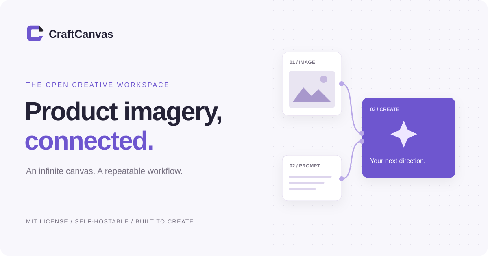
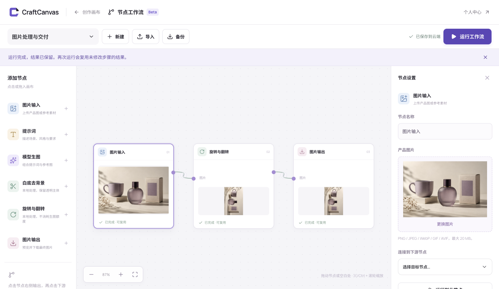

<div align="center">
  
  <p><strong>Turn product references into repeatable creative workflows.</strong></p>
  <p>Infinite canvas · Visual node workflows · Private assets · Self-hostable</p>
  <p><a href="https://craftcanvas.tinyherb1.chatgpt.site">Website</a> · <a href="README.md">简体中文</a> · <a href="LICENSE">MIT license</a> · <a href="CONTRIBUTING.md">Contribute</a></p>
</div>

CraftCanvas is an open-source workspace for product imagery. Organize references and iterations on an infinite canvas, then connect image inputs, prompts, model generation, white-background removal, transforms and outputs into reusable workflows.



The screenshot shows a local image transform. The sample product image is AI-generated. The current product UI is in Chinese.

## Quick start

Use Node.js 22.13 or newer (Node.js 24 recommended).

```sh
git clone https://github.com/CalvinQin/CraftCanvas-OSS.git
cd CraftCanvas-OSS
npm ci
cp .dev.vars.example .dev.vars
# Set a unique SETTINGS_ENCRYPTION_KEY. Generate with: openssl rand -base64 32
npm run build
npm run db:local
npm run dev:api
```

Run `npm run dev` in a second terminal and open http://localhost:3000. Register a local account, open the workflow editor, choose the image-processing template, upload an image and run it. Local transforms do not require a model key.

## Architecture

React + TypeScript in the browser, Cloudflare Workers for the API, D1 for account metadata and R2 for private images and immutable snapshots. Workflows run in the browser, with up to two ready steps at once and reusable successful results. Server-side version checks protect against conflicting saves.

## Configuration and boundaries

- Keep provider keys server-side. Never use `VITE_*` model secrets.
- Direct self-hosting ignores Sites identity headers by default. Enable `TRUST_SITES_IDENTITY=true` only behind trusted Sites ingress that controls those headers.
- Keep the browser tab open while running a workflow. Stop prevents new steps; it cannot retract submitted requests.
- Model services and hosting may cost money. Payment screens are previews; there is no live checkout.
- Email verification, self-service password recovery, account merging, background jobs and automatic historical-object cleanup are not implemented.
- Tests mock providers; live model quality, availability and billing must be checked with your own credentials.
- Public pages are pre-rendered as HTML and Markdown. Set `CRAFTCANVAS_PUBLIC_SITE_URL` to your HTTPS origin at build time; unset builds use noindex. `llms.txt` is an optional documentation aid, not a ranking guarantee.

## Development

```sh
npm run check
npm test
npm run build
npm run verify:seo
```

See the Chinese [deployment guide](docs/self-hosting.md), [workflow guide](docs/workflows.md), [architecture](Design.md), [roadmap](docs/roadmap.md) and [security policy](SECURITY.md).

MIT licensed. Third-party dependencies and marks retain their own terms; see [notices](THIRD_PARTY_NOTICES.md).
