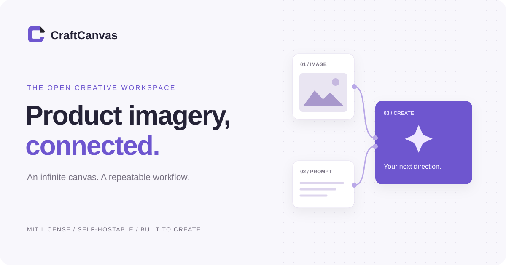
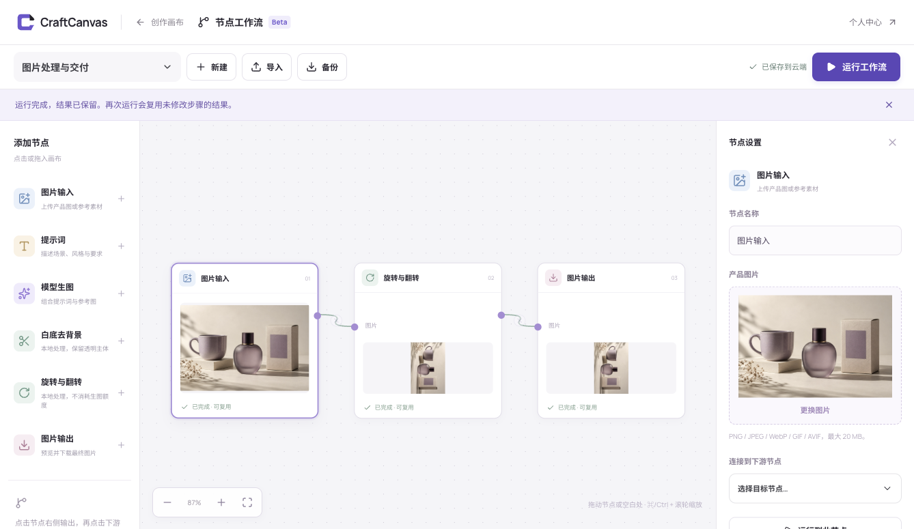
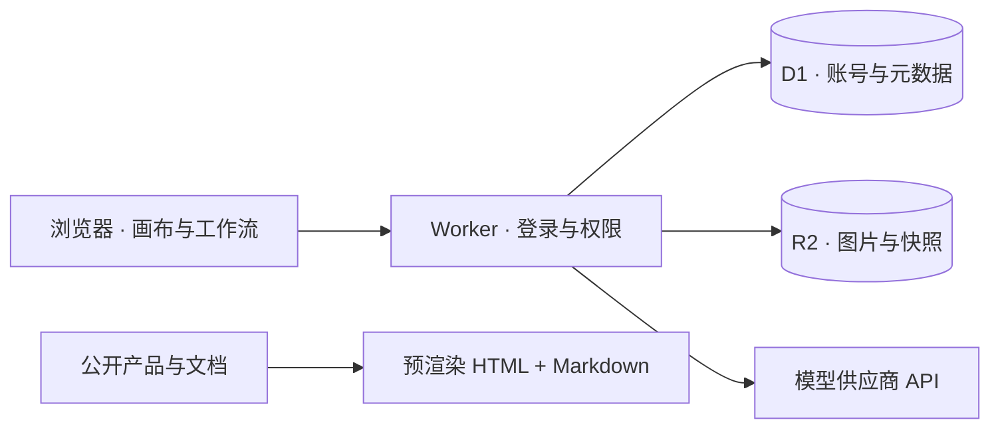

<div align="center">
  
  <p><strong>从一张产品图，到一套可以复用的创作流程。</strong></p>
  <p>无限画布 · 可视化节点工作流 · 私人素材库 · 可自托管</p>
  <p>
    <a href="LICENSE"></a>
    <a href="https://github.com/CalvinQin/CraftCanvas-OSS/actions/workflows/ci.yml"></a>
    <a href="package.json"></a>
    <a href=".nvmrc"></a>
  </p>
  <p><a href="https://craftcanvas.tinyherb1.chatgpt.site">在线站点</a> · <a href="README.en.md">English</a> · <a href="docs/getting-started.md">快速开始</a> · <a href="docs/workflows.md">工作流指南</a> · <a href="docs/self-hosting.md">自行部署</a> · <a href="CONTRIBUTING.md">参与贡献</a></p>
</div>

## 创作不止一次生成

CraftCanvas 是面向商品视觉创作的开源 Web 应用。把参考图、提示词、生成结果和处理步骤放进同一个工作台，保留每次尝试，也保留让它成功的方法。



*实际界面截图。示例商品图由 AI 生成；本地旋转流程无需模型调用。*

## 可以做什么

| 能力 | 工作方式 |
| --- | --- |
| 无限画布 | 整理图片与版本，缩放、批注、比较和导出 |
| 可视化工作流 | 连接图片、提示词、生图、白底去背景、旋转翻转和输出六类节点 |
| 复用创作步骤 | 三种模板，分支执行，成功结果缓存，完整 JSON 导入导出 |
| 私人云端保存 | 账号隔离，版本冲突保护，素材按内容去重 |
| 服务端模型代理 | 密钥留在服务端；使用记录、额度与管理员配置 |
| 自行部署 | React + Cloudflare Workers + D1 + R2；不绑定运营实例 |

## 五分钟开始本地体验

需要 **Node.js ≥ 22.13**，推荐 Node.js 24。无需模型密钥即可体验本地图片处理；AI 生成另行配置供应商密钥。

```sh
git clone https://github.com/CalvinQin/CraftCanvas-OSS.git
cd CraftCanvas-OSS
npm ci
cp .dev.vars.example .dev.vars
# 在 .dev.vars 中填写独立的 SETTINGS_ENCRYPTION_KEY
# 生成方式：openssl rand -base64 32
npm run build
npm run db:local
npm run dev:api
```

另开终端运行 `npm run dev`，访问 **http://localhost:3000**。在个人中心注册本地账号，随后打开「节点工作流」→「图片处理与交付」模板。上传图片，选择旋转方向，运行并下载结果。

部署和配置详见 [自托管指南](docs/self-hosting.md)。不要把模型密钥放进 `VITE_*` 变量或提交配置文件。

## 运行结构



工作流在浏览器中调度，图片处理在本地执行，只有生成/分析步骤调用模型。云端写入检查版本，避免多个页面覆盖彼此的修改。详见 [架构说明](Design.md)。

## 开始前了解这些边界

- 工作流执行时需要保持页面打开；停止不会撤回已经提交的模型请求。
- MIT 开源许可不包含模型 API 或托管费用。会员和充值界面尚未接通真实收款。
- 邮箱验证、自助找回密码、账号合并、后台任务队列与历史对象自动清理尚未实现。
- 模型接口有自动化替身测试；实际可用性、出图质量与费用需要部署者用自己的新密钥验证。
- Sites 托管可使用 ChatGPT 登录；直接自托管默认忽略外部身份头，只在可信 Sites 入口开启该能力。

## 开发与贡献

```sh
npm run check
npm test
npm run build
npm run verify:seo
```

[贡献指南](CONTRIBUTING.md) · [安全报告](SECURITY.md) · [路线图](docs/roadmap.md) · [更新记录](CHANGELOG.md)

## 许可与致谢

代码使用 [MIT 许可证](LICENSE)，允许商用和修改，分发时保留许可与版权声明。第三方依赖、字体及供应商品牌标识保留各自条款，见 [第三方说明](THIRD_PARTY_NOTICES.md)。项目与模型供应商之间没有合作或背书关系。
